# Reflection: How was this talk designed?
## Considerations

:::incremental
- This module requires that you show critical thinking. This skill is threatened by generative AI.
- At the same time, you are allowed to use as AI in the preparation of these assessments as long as you **disclaim it**, **write your own text** and **don't upload module documents to a chatbot**. Just remember that **you won't have a computer to help you in the final research meeting**.
- As science graduates, you are expected to have some technical knowledge of AI.
- This lecture is structured like your assessment.
- I chose a research question based on my reading of secondary sources of analysis by Hao[@haoEmpireAIDreams2026] and Doctorow.[@doctorowReverseCentaursGuide2026]
- My research question: **What are the present and ongoing costs of LLMs as a technology?**
- For my background, I used some well sourced explainer videos as a starting point, and adapted the information for the audience, making my own visuals.[@TransformersTechLLMs, @andrejkarpathy1hrTalkIntro2023]
- For primary sources, I can't be exhaustive, so I'll focus on three separate areas which are well documented: environmental, social, and human harms.
- In preparing this talk, I used Google and Google Scholar for finding literature, Affinity Designer for making figures, Quarto for making slides, and Mistral AI to help me debug Quarto slides.
:::

# Background: What is AI and how does it work?
## Definitions

::: {.column width="50%"}

::: {.fragment fragment-index=1}
* **Artificial Intelligence (AI)**: The ability for computers to accomplish tasks previously reserved for human intelligence.
:::

::: {.fragment fragment-index=2}
* **Machine Learning (ML)**: A field of AI where training data is generalised to draw conclusions about unseen data.
:::

::: {.fragment fragment-index=3}
* **Large Language Model (LLM)**: An type of **neural netwok** ML model where the training and unseen data is mostly language-based.
:::

::: {.fragment fragment-index=4}
* **Chatbot**: A program that responds to user language to generate new language as a reply.

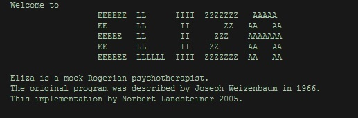{width=70% fig-alt="A conversation with the chatbot ELIZA. https://commons.wikimedia.org/wiki/File:ELIZA_conversation.jpg See page for author, Public domain, via Wikimedia Commons" fig-align="center"}
:::

:::

::: {.column width="50%"}

::: {.fragment fragment-index=1}
{height=1.7in fig-alt="Picture of an abacus. By Pearson Scott Foresman - This image has been extracted from another file, Public Domain, https://commons.wikimedia.org/w/index.php?curid=3503686" fig-align="center"}
:::

::: {.fragment fragment-index=2}
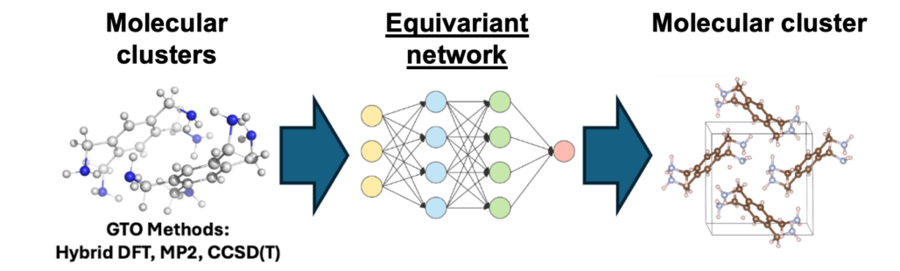{width=90% fig-alt="A molecular cluster turning into a neural network turning into a crystal structure. Ankur K. Gupta, Miko M. Stulajter, Yusuf Shaidu, Jeffrey B. Neaton, Wibe A. de Jong; Equivariant Neural Networks Utilizing Molecular Clusters for Accurate Molecular Crystal Lattice Energy Predictions. ACS Omega 24 September 2024; 9 (38): 40269–40282 https://doi.org/10.1021/acsomega.4c07434" fig-align="center"}
:::

::: {.fragment fragment-index=3}
{width=20% fig-alt="ChatGPT logo." fig-align="center"}
:::

:::
---
## Overall operation
- LLMs acts as machines which receive text and generate the next token (a word or piece of text).

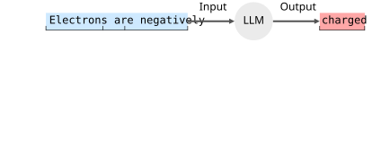{width=100% fig-alt="Diagram of words being generated sequentially to make a sentence." .absolute top=120 left=10 .fragment}

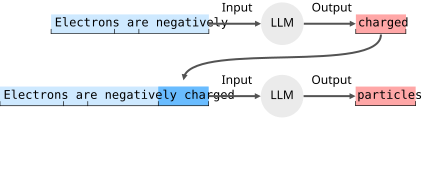{width=100% fig-alt="Diagram of words being generated sequentially to make a sentence." .absolute top=120 left=10 .fragment}

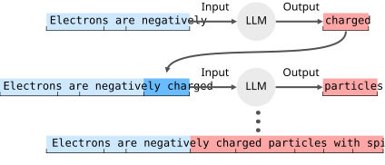{width=100% fig-alt="Diagram of words being generated sequentially to make a sentence." .absolute top=120 left=10 .fragment}

## Embedding
- To encode and generate text, sections of text are mapped on onto a many-dimensional space (12,288 or GPT-3). This is called **embedding**.

{width=60% fig-alt="An xy plot showing words with similar meaning mapping to vectors which are close together." .absolute top=120 left=120 .fragment}

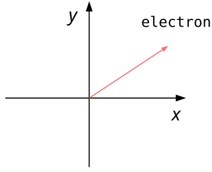{width=60% fig-alt="An xy plot showing words with similar meaning mapping to vectors which are close together." .absolute top=120 left=120 .fragment}

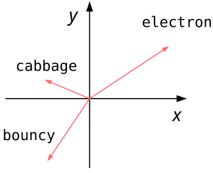{width=60% fig-alt="An xy plot showing words with similar meaning mapping to vectors which are close together." .absolute top=120 left=120 .fragment}

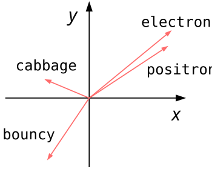{width=60% fig-alt="An xy plot showing words with similar meaning mapping to vectors which are close together." .absolute top=120 left=120 .fragment}

## Neural networks

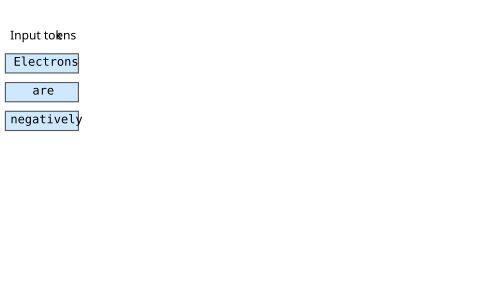{width=100% fig-alt="Diagram showing how a series of tokens goes through a series of vector operations to yield probabilities for next tokens." .absolute top=0 left=0 .fragment}

{width=100% fig-alt="Diagram showing how a series of tokens goes through a series of vector operations to yield probabilities for next tokens." .absolute top=0 left=0 .fragment}

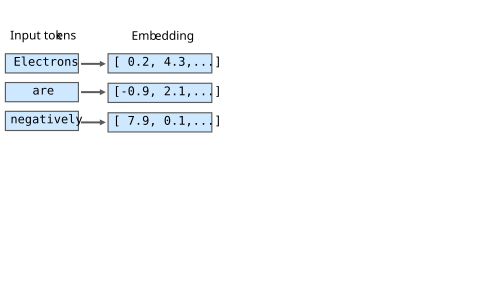{width=100% fig-alt="Diagram showing how a series of tokens goes through a series of vector operations to yield probabilities for next tokens." .absolute top=0 left=0 .fragment}

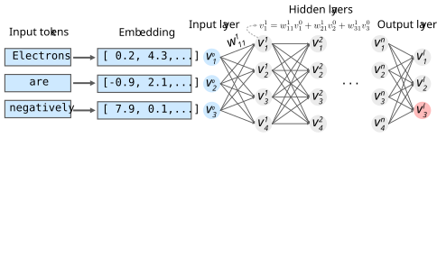{width=100% fig-alt="Diagram showing how a series of tokens goes through a series of vector operations to yield probabilities for next tokens." .absolute top=0 left=0 .fragment}

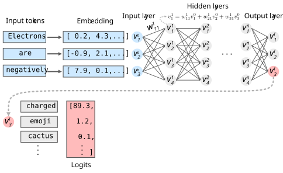{width=100% fig-alt="Diagram showing how a series of tokens goes through a series of vector operations to yield probabilities for next tokens." .absolute top=0 left=0 .fragment}

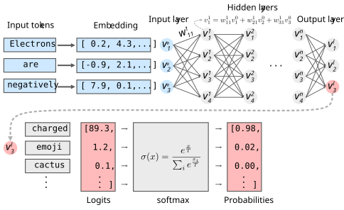{width=100% fig-alt="Diagram showing how a series of tokens goes through a series of vector operations to yield probabilities for next tokens." .absolute top=0 left=0 .fragment}

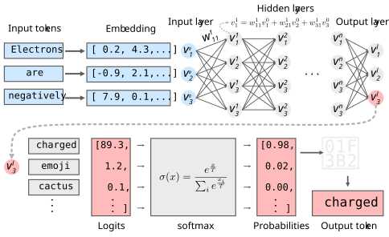{width=100% fig-alt="Diagram showing how a series of tokens goes through a series of vector operations to yield probabilities for next tokens." .absolute top=0 left=0 .fragment}

## Training

- To build an LLM, sample text is gathered and the weights are optimised in such a way that the text predictions match the training set.

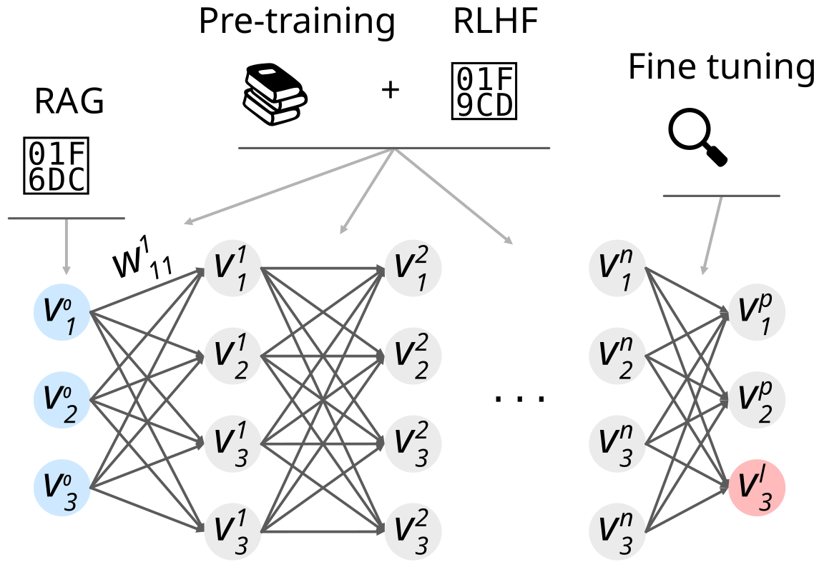{width=100% fig-alt="The neural network from the previous slide surrounded by logos representing pre-training, reinforced learning from human feedback, fine tuning, and retrieval augmented-generation." fig-align="center"}

:::incremental
- 📚**Pre-training**: 500 B tokens of textual data tune all the weights.

- 🧍**Reinforced Learning from Human Feedback (RLHF)**: AI annotation workers provide data to make the chatbot behave as intended.

- 🔍**Fine tuning**: A smaller amount of data and instructions tune the last few layers of weights to give the chatbot more specialised behaviour.

- 🛜**Retrieval-Augmented Generation (RAG)**: An additional data set (e.g. from an internet search) is fetched to complement the input prompt.
:::

# Demo: Local vs commercial LLM

# Summary: What are the ongoing costs of the operation of AI?
## Environmental cost

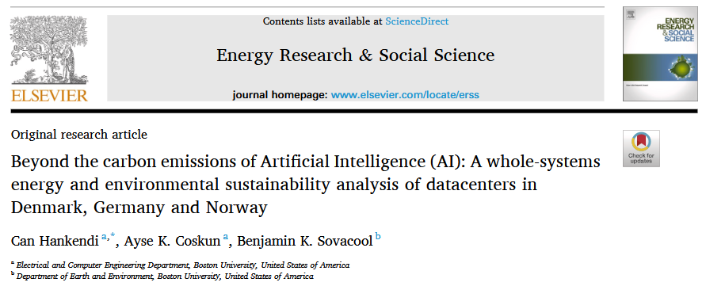{width=50% fig-alt="An article header titled: Beyond the carbon emissions of Artificial Intelligence (AI): A whole-systems energy and environmental sustainability analysis of datacenters in Denmark, Germany and Norway." fig-align="center"}

:::incremental
- Digital content consumption is projected to account for 40% of our per capita 1.5 C carbon budget and 55% of the earth's carrying capacity for minerals and metals.[@istrateEnvironmentalSustainabilityDigital2024]
- Much of this demand is driven by AI technologies and manifested by the proliferation of data centres.
- Hankendi and coworkers calculated the estimated ecological cost of 36 European data centres. including energy, material usage, water consumption, and waste evacuated.
- The information they collected included energy cost of construction, transportation, and operation, material usage, water consumption, waste disposal.
:::

## Environmental cost (cont.)

![Share of carbon footprint spent by a typical European datacentre by different phases of life.[@hankendiCarbonEmissionsArtificial2026a]](./assets/operational_cost.png){width=30% fig-alt="Pie chart of the carbon footprint of a data centre, showing that 92.1% comes from its operation." fig-align="center"}

:::incremental
- The 2025 International Energy Agency report estimates the global power consumption of data centres to double by 2030. In regions with many clusters, their useage is a sizeable share of all energy consumption.[@EnergyAIData2025]

- The present study confirms that this cost is ongoing and will not slow down once the infrastructure has been deployed.
:::

## Social costs
- There is mounting evidence that reliance on chatbots for our work is impacting our cognitive function.

![Statistics of participants struggling to quote their own essay after having written it using different assistive technologies. Figure adapted from data available in preprint.[@kosmynaYourBrainChatGPT2025]](./assets/retention.svg){width=40% fig-alt="Bar chart showing that 82% of participants who wrote an essay using AI struggled to quote their own essay, vs 11% for those not using AI." fig-align="center"}

## Social costs (cont.)

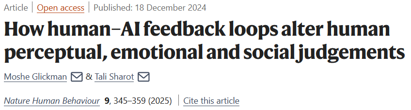{width=40% fig-alt="An article header titled: How human-AI feedback loops alter human perceptual, emptional and social judgements." fig-align="center"}

:::incremental
- Glickman and Sharot investigated whether biases in AI training sets could amplify user's own biases.

- Participants (n=50, control=50) were asked to select who would most likely be a financial manager out of a list of faces, before and after seeing AI-generated bank managers.
:::

## Social costs (cont.)

![a) Diagram of the experimental design. b) Plots of the bias change for different types of faces for the experimental and control groups.[@glickmanHowHumanAI2025]](./assets/bias.png){width=150% fig-alt="The experimental group is 6% likelier to select a white male face than before exposure to AI." fig-align="center"}

- The bias towards white men being selected increased significantly.

## Human cost

::: {.column width="50%"}
- Due to its enormous demand for data, infrastructure, and energy to operate, the control of AI tools is concentrated in the hands of only the most powerful.[@instituteArtificialPower20252025]

- When decision making is made by powerful bodies, it can come at the expense of less powerful groups.

- Meta and their data annotation subcontractor Sama face multiple lawsuits, accused of firing employees who raised concerns about the psychological impact of their work moderating traumatic content.[@sama]

:::

::: {.column width="40%"}
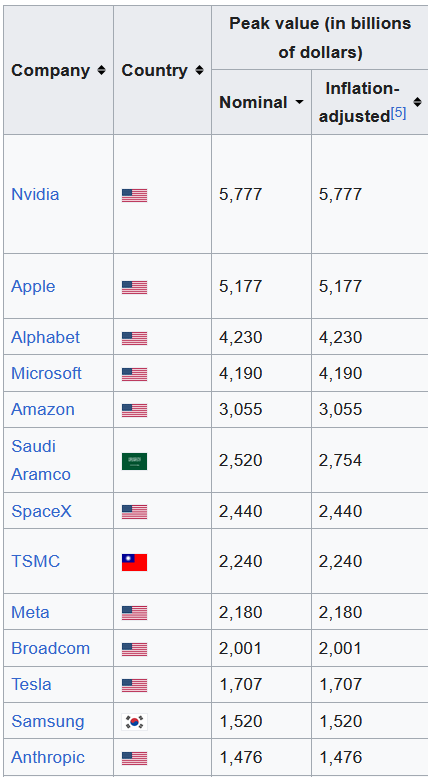{width=150% fig-alt="The top 13 valued companies all have a link to tech." fig-align="center"}
:::

## Human cost (cont.)

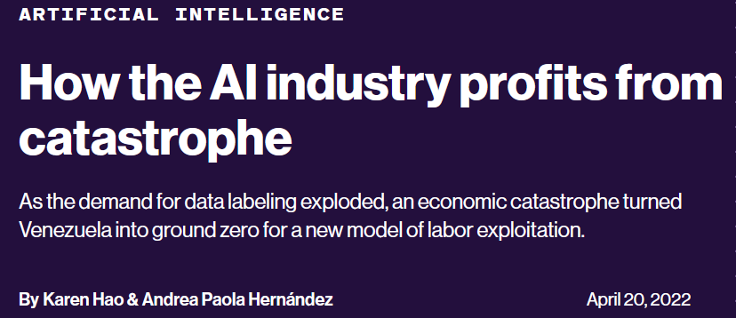{width=50% fig-alt="An article header titled: How theAI industry profits from catastrophy." fig-align="center"}

:::incremental
- Hao and Hernández investigated how data annotation work was targetted at populations in crisis, willing to accept poor working conditions.[@pageHowAIIndustrya]

- They interviewed Venezuelan data annotation workers exiled in Colombia. They also conducted data annotation work themselves to report on their working conditions.

- They reported that after two hours of work in South America for a US based company, a first-time worker earned 0.11 USD. The minimum wage in the US is 7.50 USD per hour.

- When workers streamline their annotation by using AI to help them, data annotation companies blacklist their country and target their advertising to other regions. This is how data annotation companies have spread from the Philippines, to Kenya, Venezuela, Colombia, and most recently India.
:::

# Analysis: What patterns do we discern in the cost of AI?
## Analogy with colonialims

::: {.fragment}
- The AI industry exerts an ecological, social, and human cost in an ongoing way.
:::
::: {.fragment}
- The distribution of the cost is highly uneven geographically and by population.
:::
::: {.fragment}
- Hao compares this paradigm to colonial exploitation.[@haoEmpireAIDreams2026]

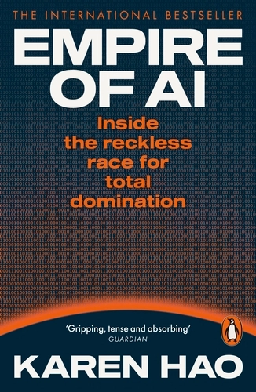{width=25% fig-alt="A book cover: Empire of AI by Karen Hao." fig-align="center"}
:::

## Limitations

:::incremental
- This was just a sample of ongoing costs of using AI. We have not touched on the impact on creative labour[@UnderstandingImpactAI] or deliberate abuse[@ExpertCommentChatbotdriven2026] and disinformation[@wirtzAIbasedDigitalDisinformation2026] enabled by AI.

- The papers did not attempt to quantify compensatory gains in LLM-enabled breakthroughs in green tech.

- There are tools to replace RLHF with AI generated feedback, but they depend on other models trained with RLHF.[@leeRLAIFScalingReinforcement2023]

- There are strategies to identify and mitigate training bias[@hasanzadehBiasRecognitionMitigation2025] but the model developers are free to decide whether and how to use them.

- The social and human costs are inseparably linked to powerful companies being the custodians of AI tech.

- And the development of AI and scale of its use is contingent on the concentration of power in companies.

- The only way to use AI with full agency over its cost is to run models locally with local weights and a transparent training methodology. This is very hard to do.[@OpenWeightsNot2025, @widderOpenBusinessBig2023]
:::

# Outlook: What should we do with this knowledge?
## Individual responsibility

:::incremental
- The costs discussed today become severe at scale, a bit like carbon emissions.

- Each potential user should be aware of the broader impact of these technologies so they can decide when and where to use them or deliberately abstain.

- There are many more individual costs to discuss, such as impacts on learning, critical thinking, and attention.
:::

## For this module

- You may be tempted to use AI in this module. Whatever technology you use to produce your work, you should record it in your reflection.

- Your cover sheet should specifically list any way in which you used AI.

| Use                      | Warning                                                                                                | Alternative                                     |
|--------------------------|--------------------------------------------------------------------------------------------------------|-------------------------------------------------|
| Literature search        | Use RAG to go straigt to the source.                                                                   | Web of Science, PubChem, Google Scholar         |
| Explaining concepts      | Verify that you have understood by explaining them to someone else.                                    | Lecturers, texbooks, web-resources              |
| Summarising content      | Find which parts of the original text relate to the summarised statemets.                              | Make use of the abstract, intro, and conclusion |
| Making figures           | Make sure that precision is present where required. Consider generating code which generates a figure. | Photoshop, Chemdraw, hand drawing, Inkscape     |
| Translating your writing | Ensure that you are able to discuss your work in the same language you have submitted in writing.      | Academic Communication Centre                   |
| Generating text          | This is a bad idea. I strongly advise you don't do this, as you will struggle to discuss the writing. | Use your brain                                  |

## Tips if you use chatbots

:::incremental
- Model developers publish their own advice.[@PromptingBestPractices]

- Be precise, don't worry about being concise.

- Add lots of context and explain why you are requesting different features.

- Give the chatbot a role.

- Tell it about yourself, at your own risk.
:::

# Bibliography